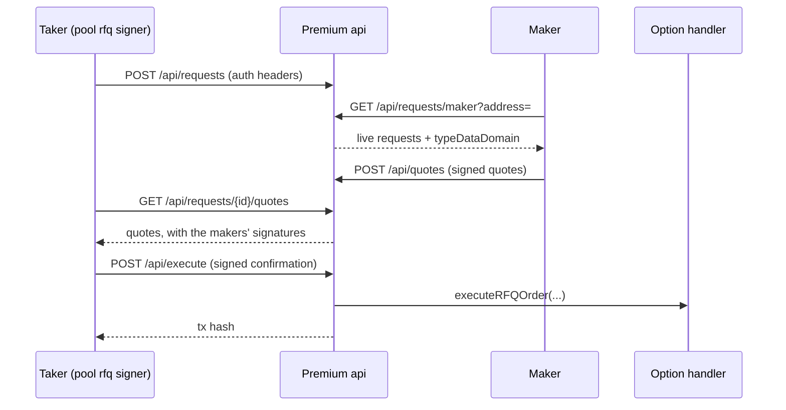

# Premium RFQ integration

The premium RFQ api is plain HTTP: no websocket and no auction clock. A taker
opens a request on a pool, makers post signed quotes against it, and the taker
picks one and has the api settle it on chain. Every step is one CLI call, so the
SDKs run each as a short lived process. None of it goes through `connect`.

| Network | Base url |
| --- | --- |
| production | `https://premium.rysk.finance` (the CLI's default) |
| testnet | `https://insti-testnet.rysk.finance` |

Pass `--url` to point the CLI somewhere else, or set `RYSK_PREMIUM_URL` once.

## Roles

- **Taker:** always a **pool**, never a wallet. The key that signs for the taker
  has to be one of the pool's on chain RFQ signers. `GET
  /api/pools/{pool}/is-rfq-signer?signer=` answers `200` when it is.
- **Maker:** any key. A request may list the only `makers` allowed to quote it.
- **Option handler:** the pool's settlement contract (`optionHandler` on the
  pool). Quotes and confirmations are both signed under its EIP712 domain.

## The flow



### 1. The taker opens a request

```sh
ryskV12 premium request --batch requests.json --chain_id 84532 --nonce <n>
```

The batch is a json array, sent to the api exactly as written. Each request:

| Field | |
| --- | --- |
| `taker` | the pool |
| `asset` | the pool's `underlying` |
| `collateralAsset`, `premiumAsset` | assets the pool holds |
| `usd` | a strike asset registered on the chain |
| `isPut` | matches the pool's `type` |
| `isTakerBuy` | `false`: the pool writes and the maker pays the premium. `true`: the pool buys |
| `strike` | 1e8 |
| `quantity` | 1e18 |
| `expiry` | unix **seconds** |
| `validUntil` | unix **milliseconds**, before the expiry |
| `isPremium` | `true`, on every request |
| `makers` | optional: the only makers who may quote |

The post is authenticated with EIP712 auth headers (`X-Chain-Id`, `X-Nonce`,
`X-Signature`, signed under the `Authentication` domain). The api answers `201`
with **no body**, because ids are assigned server side. Find the request again
through `premium taker-requests --taker <pool>`.

### 2. The maker finds it

```sh
ryskV12 premium requests --maker <0xmaker>
```

This lists the live requests the maker may quote. Each one carries a
`typeDataDomain`: the option handler to sign against. Poll it; the api pushes
nothing. Stay under the rate limit of 30 requests a second per ip.

### 3. The maker quotes

```sh
ryskV12 premium quote --batch quotes.json        # a json array, or "-" for stdin
```

A quote repeats the request's terms exactly and adds the maker's own fields:
`maker`, `nonce`, `price` (1e18 per option, non zero) and `validUntil`. Only
`requestId`, `maker`, `price`, `nonce`, `validUntil` and `signature` are sent,
because the api rebuilds the signed terms from the stored request. So a term
that differs from the request does not fail on its own; it yields a signature
that will not verify.

- `validUntil` is unix **seconds**, strictly between now+2min and now+10min.
- The domain is the request's `typeDataDomain`
  (`PremiumOptionHandler`, version `1`, the option handler).
- The post always answers `200`, with any rejections listed under `failures`.
  The CLI exits non zero when `failures` is not empty.

The post returns no ids. A quote's id comes from the maker's own book:

```sh
ryskV12 premium quotes --maker <0xmaker>         # live quotes; match on nonce
ryskV12 premium quote-status --id <quote_id>     # one quote, whatever its status
ryskV12 premium cancel --id <quote_id> --chain_id 84532 --nonce <n>
```

A quote stays on the book until it is taken, cancelled or past its
`validUntil`. To keep a price standing, requote before the 10 minute window
closes.

### Knowing a quote was filled

The api pushes nothing, so a maker polls. Two reads answer it:

```sh
ryskV12 premium trades --account <0xmaker> [--chain_id 84532] [--pool <0xpool>]
ryskV12 premium quote-status --id <quote_id>
```

- **`trades`** (`GET /api/trades`) lists the account's settled trades, newest
  first. Rows come from indexed chain events, so a trade shows once its
  transaction is mined. Each row has `pool`, `action`, `otoken`,
  `otokenSymbol`, `expiry`, `strike`, `isPut`, `quantity` (1e8),
  `totalPremium`, `premiumAsset`, `timestamp` and `txHash`. A row does not name
  the quote: match it on pool, option and quantity.
- **`quote-status`** turns `TAKEN` as soon as the taker's transaction is sent,
  before it is mined. The other quotes on that request turn `CANCELLED`.

### 4. The taker takes a quote

```sh
ryskV12 premium request-quotes --id <request_id>
ryskV12 premium execute --quote_id <quote_id> --nonce <n>
```

`execute` reads the quote, its request and the pool's option handler from the
api. It signs a `Confirmation` under the handler's domain that embeds the
maker's quote signature, then posts it to `/api/execute`. That route takes no
auth headers: the two signatures inside are the authority. The api's operator
sends the transaction and answers `201` with its hash. The trade is final once
that transaction is mined. A `400` whose body is none of the api's own messages
is the chain's revert, passed through verbatim.

To withdraw a request, use `premium cancel-request --id <request_id> --chain_id
84532 --nonce <n>`. That also cancels every quote on it.

## Funds

- **`isTakerBuy: false`:** the pool writes the option and locks its own
  collateral. The maker pays `ceil(quantity_e8 × price / 10^(26 − decimals))` of
  the premium asset, which the option handler pulls with `transferFrom`. The
  maker needs an allowance for the option handler on the premium asset, or the
  execute reverts.
- **The confirmation's other amounts:** `collateralAmount` and `gasFee` are
  signed, but this path does not charge them. Send `0` for both.

## Nonces

A nonce is a decimal uint64 and works once per address. Quote nonces and auth
nonces (`cancel`, `request`, `cancel-request`) share one keyspace, and
confirmation nonces are checked the same way. Draw them from a single counter
per key that survives restarts. Every SDK ships a `NonceCounter` backed by a
file. Unix nanoseconds work too.

## Errors worth knowing

| Answer | Meaning |
| --- | --- |
| `401 nonce already used` | the auth nonce was spent before |
| `403` | the key is not an rfq signer on the request's pool |
| `429` with body `cc` | rate limited |
| `404 page not found` | the url has no rfq routes, so it is the wrong host; the CLI says so |
| `execution reverted` on execute | usually a missing premium allowance, or an option handler that is not on the current implementation |
