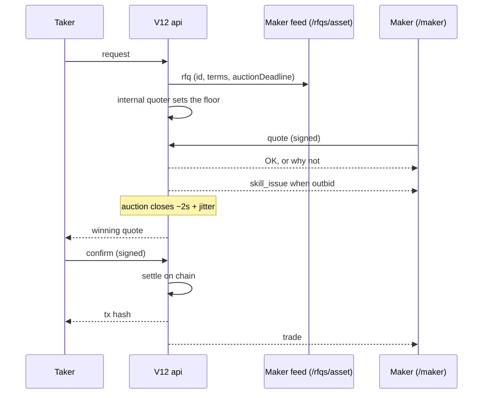

# V12 RFQ integration

V12 runs over websockets. A taker sends an RFQ, the api holds a short auction
that makers bid on in real time, and the taker confirms the winning quote,
which the api settles on chain. Makers keep a balance deposited with Rysk, and
premiums are paid out of it.

| Network | Websocket base |
| --- | --- |
| production | `wss://v12.rysk.finance` |
| testnet | `wss://rip-testnet.rysk.finance` |

The HTTP api is on the same host, over `https`.

> Testnet runs the strategies (multi-leg) protocol. Its requests,
> quotes and confirmations have a different shape from what is described here,
> which is the protocol production runs.

## Connections

The CLI holds each websocket as one long lived `connect` process. Every server
message comes out on its stdout, one json-rpc message per line. Commands go in
on its stdin, one json array of args per line, and are signed and sent from
inside that process. The SDKs wrap exactly this.

| Endpoint | Who | What |
| --- | --- | --- |
| `/rfqs/<asset>` | maker | the RFQ feed for one asset; listen only |
| `/maker` | maker | quotes, deposits and withdrawals, balances, positions, redemption opt in; trade and outbid notifications |
| `/taker` | taker | `request`, `confirm`, `inventory`, `assets` |
| `/redemptions/<account>` | maker | redemption updates for an account |

```sh
ryskV12 connect --url wss://v12.rysk.finance/rfqs/<asset> < /dev/null   # listen only
ryskV12 connect --url wss://v12.rysk.finance/maker                       # commands on stdin
```

A maker usually runs one feed per asset it makes markets in, plus one `/maker`
connection. A `/maker` connection is bound to the account of the first quote
sent on it, and quoting for another account on it is refused. That first quote
is also what registers the connection for the maker's `skill_issue` and `trade`
notifications. A connection that has never quoted receives neither.

## The flow



### 1. Before quoting: funds

The premium a maker pays comes out of its Rysk balance, not its wallet:

```sh
ryskV12 approve --chain_id <id> --rpc_url <rpc> --amount <usdc>   # lets the mmarket pull the deposit
```

```json
["transfer", "--chain_id", "<id>", "--asset", "<usdc>", "--user", "<0xmaker>", "--amount", "<usdc>", "--is_deposit", "--nonce", "<n>"]
```

The transfer is sent on `/maker`. Leave out `--is_deposit` to withdraw. The api
checks the wallet's balance and allowance, then moves the funds through the Rysk
contract. Read the balance back with `["balances", "--account", "<0xmaker>"]`.
A quote is refused when the balance cannot cover its premium.

### 2. An RFQ arrives

The feed delivers each RFQ as a json-rpc message whose `id` is the RFQ id and
whose `result` is the request:

```json
{"jsonrpc":"2.0","id":"<rfq id>","result":{
  "asset":"0x…","chainId":8453,"expiry":1767254400,"isPut":false,"isTakerBuy":false,
  "quantity":"1000000000000000000","strike":"350000000000","taker":"0x000…000",
  "usd":"0x…","collateralAsset":"0x…","auctionDeadline":1767100000000}}
```

- The taker is anonymous: `taker` is always the zero address.
- `auctionDeadline` is unix **milliseconds**.
- The taker sells (`isTakerBuy: false`): the maker buys the option and pays the
  premium.

### 3. The maker quotes

```json
["quote", "--rfq_id", "<rfq id>", "--asset", "0x…", "--chain_id", "8453", "--expiry", "1767254400",
 "--strike", "350000000000", "--quantity", "1000000000000000000", "--maker", "<0xmaker>",
 "--nonce", "<n>", "--price", "<1e18 per option>", "--valid_until", "<unix seconds>",
 "--usd", "0x…", "--collateral", "0x…"]
```

- **Terms:** copy them from the RFQ unchanged. The api rejects a mismatch by
  name: asset, collateral, usd, chain, side, strike, quantity, expiry.
- **`--price`:** the premium per option in USD, 1e18. For the whole quantity the
  maker pays `quantity × price / 1e30` of the 6 decimal strike asset.
- **`--valid_until`:** unix **seconds**, more than 30 seconds out (60 when the
  taker is a smart contract wallet).
- **Signing:** the quote is signed under the Rysk EIP712 domain (`rysk`,
  `0.0.0`, the chain's Rysk contract). The CLI defaults to it.

The api answers on `/maker` under the RFQ id. `"OK"` means the bid leads. An
error means it doesn't:

| Error | Meaning |
| --- | --- |
| `A better quote exists` | outbid; `data` is the standing best price |
| `Quote must beat the best by at least 10 bps` | too small a raise |
| `Quoting after the auction deadline requires having held the best price before it` | late, and not a leader |
| `Maker has no funds deposited` / balance errors | deposit first |
| `valid until too close` | `--valid_until` is less than 30 seconds out |

When another maker takes the lead, the old leader gets an id `skill_issue`
message: `{"rfqId", "assetAddress", "chainId", "newBest", "yours"}`. To stay
in, requote above `newBest`.

### 4. The auction

- **Window:** two seconds from the RFQ. It actually closes a random 0 to 500ms
  after `auctionDeadline`, so nobody can time the close.
- **Floor:** the api's internal quoter always bids. Its price is the taker's
  floor, and an external quote only wins by beating it.
- **Raises:** a raise has to clear the standing best by at least 10 bps.
- **After the deadline:** only makers who led before it may still bid, and
  those bids still count.
- **Result:** the highest bid wins, and the taker receives that quote, with its
  signature, as the answer to its `request`.

### 5. The taker confirms

The taker signs a `Confirmation` under the same Rysk domain. It embeds the
winning quote and its signature, plus:

- **`collateralAmount`:** the quantity in the collateral's decimals for a call,
  or `quantity × strike` in the 6 decimal strike asset for a put.
- **`gasFee`:** the api's estimate from `POST /api/gas`. It is signed, and the
  api refuses a confirmation whose fee is below its own estimate.
- **`validUntil`:** unix seconds, not signed.

Before settling, the api checks:
- **Signatures:** both are valid.
- **Nonces:** the taker's and the maker's are unused.
- **Taker:** it holds the collateral and has approved the **margin pool** for it.
- **Maker:** its deposited balance still covers the premium.

It then sends the trade on chain and answers the taker with the transaction
hash. Every `/maker` connection of the winning maker gets an id `trade` message
whose result is the confirmation, including `txHash`.

On the CLI, `request`, `confirm` and `inventory` are the taker's commands on a
`/taker` connection. `confirm --quote '<winning quote json>' --nonce <n>`
fetches the gas fee and signs. `approve --spender <margin pool>` gives the
collateral allowance.

## After the trade

- **Positions:** `["positions", "--account", "<0xmaker>"]` lists the maker's
  oTokens.
- **Redemption at expiry:** a maker opts each oToken in or out with
  `will_redeem` on `/maker`.
- **Redeeming now:** `ryskV12 self-redeem` redeems expired oTokens immediately,
  over HTTP.

## Nonces

A nonce is a decimal uint64 and works once per address for each kind of
action: quotes, transfers and confirmations are checked separately. Drawing
every nonce for a key from one counter that survives restarts keeps all of them
unique. Every SDK ships a file backed `NonceCounter`.
